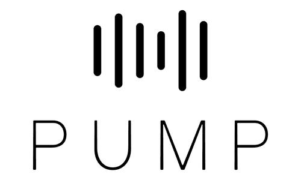

  

<h1 align="center">PUMP Consortium</h1>

A multi-institution collaboration on machine perfusion of donor livers: a shared registry, shared tooling and shared analyses.

## What lives here

For now, the scores computed for PUMP livers and the code that produces them:

| Score | What it is | Computed from |
| --- | --- | --- |
| NMP Performance Index | A single 0 to 1 score of how a donor liver behaved on the pump, from 20 on-pump features in five domains; versioned, outcome-free scoring rule | NMP time series and perfusion summary |
| L-GrAFT7 | Liver Graft Assessment Following Transplantation, 7-day version: a log-odds of early graft failure from daily AST, INR, bilirubin and platelets over post-operative days 1 to 7 (authors' formula) | Post-operative labs |
| MEAF | Model for Early Allograft Function: a 0 to 10 severity score from peak ALT and INR over days 0 to 3 and bilirubin on day 3 | Post-operative labs |
| EASE | Early Allograft failure Simplified Estimation: a log-odds of 90-day early allograft failure from MELD at transplant, red cells transfused, early vessel thrombosis, centre volume and the day 1 to 10 kinetics of AST, platelets and bilirubin | Post-operative labs and recipient record |

The [`scores`](https://github.com/pump-consortium/scores) repository holds the per-liver score workbooks for both centres, one workbook per score, each with a README sheet giving the formula, the conventions and the counts, and every input value the score was built from. The computation, the validation experiments and the frozen definitions live with the code. Raw registry exports and feature tables are **not** stored in these repositories; they live on the governed data share and are available to entitled members through the registry's data steward. The score workbooks are de-identified (PUMP IDs only) and are for members of this organisation; do not copy them outside it.

## Member institutions

- Icahn School of Medicine at Mount Sinai, New York
- Cleveland Clinic, Cleveland

## Working in this organisation

- Repositories are private to members. Ask the organisation owners for access.
- Every analysis that produces a number used in a paper has a numbered script and a written output in its repository, so results can be reproduced from the registry export it names.
- Model rules are frozen and versioned (for example `nmp_index_rule_v3_median`); a rule is never edited in place.
- Do not commit registry data. Each repository's `.gitignore` excludes its `data/` folder; if a data file is committed by mistake, tell an owner before anything else, because Git history keeps it.

## Contact

Organisation owners are listed on the People page. For data access, contact the registry's data steward.
